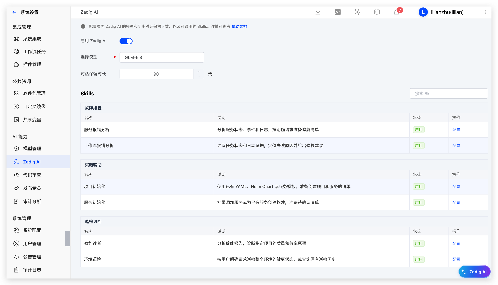

本文介绍如何配置和使用 Zadig AI。Zadig AI 基于已接入的模型，结合当前页面上下文，完成故障排查、项目与服务初始化，以及环境与效能诊断。

## 配置

访问 `系统设置` -> `Zadig AI`，配置使用的模型、历史对话保留天数，以及可调用的 Skills。

参数说明：

- `启用 Zadig AI`：开启或关闭 Zadig AI。
- `选择模型`：Zadig AI 对话使用的模型，从已接入的模型中选择。
- `对话保留时长`：历史对话的保留天数。

### Skills

Skills 是 Zadig AI 可调用的能力，支持按名称搜索。每项 Skill 可单独启用或关闭，点击`配置`可调整该项能力。

| 分组 | 名称 | 说明 |
| --- | --- | --- |
| 故障排查 | 服务报错分析 | 分析服务状态、事件和日志，按明确请求准备修复清单 |
| 故障排查 | 工作流报错分析 | 读取任务状态和日志证据，定位失败原因并给出修复建议 |
| 实施辅助 | 项目初始化 | 使用已有 YAML、Helm Chart 或服务模板，准备创建项目和服务的清单 |
| 实施辅助 | 服务初始化 | 批量添加服务或为已有服务创建构建，准备确认清单 |
| 巡检诊断 | 效能诊断 | 分析效能报告，诊断指定项目的质量和效率瓶颈 |
| 巡检诊断 | 环境巡检 | 按用户明确请求巡检整个环境的健康状态，或查询原有巡检历史 |

## 使用

在页面右下角打开 Zadig AI，选择快捷场景，或直接询问当前页面的问题。Zadig AI 会结合当前项目、工作流或环境给出分析和建议。历史对话可在面板中继续查看。
