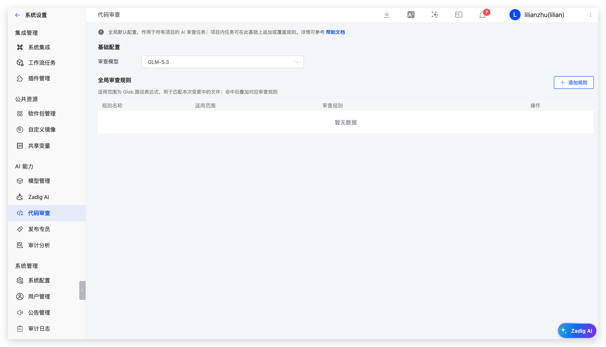

本文介绍 AI 代码审查的全局配置。该配置作用于所有项目的 AI 审查任务，项目内任务可在此基础上追加或覆盖规则。

## 配置

访问 `系统设置` -> `代码审查`，配置审查模型与全局审查规则。

### 基础配置

- `审查模型`：AI 审查使用的模型，从 [模型管理](/cn/Zadig%20v5.1/ai/ai-model/) 中已接入的模型里选择。

### 全局审查规则

适用范围为 Glob 路径表达式，用于匹配本次变更中的文件；命中后叠加对应审查规则。点击`添加规则`新增规则。

- `规则名称`：规则的名称。
- `适用范围`：Glob 路径表达式，匹配本次变更中的文件。
- `审查规则`：命中文件后叠加的审查规则。

## 使用

项目中创建 AI 审查时，会使用此处的审查模型和全局审查规则。仓库还可以配置自己的审查规则，在全局规则上追加或覆盖。任务的配置与执行方式见 [AI 审查](/cn/Zadig%20v5.1/project/scan/#ai-审查)。
