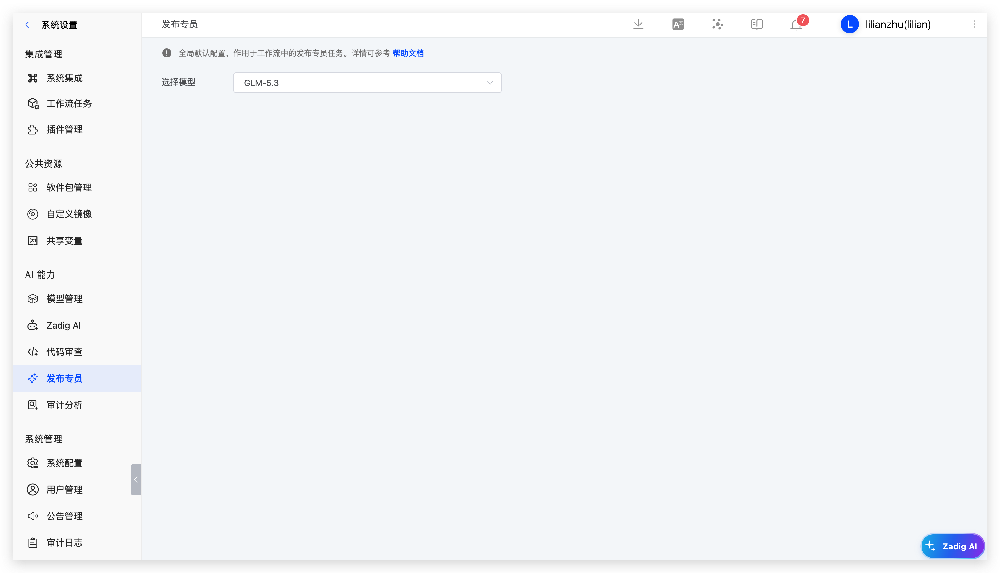

本文介绍 AI 发布专员的全局配置。该配置作用于工作流中的发布专员任务。

## 配置

访问 `系统设置` -> `发布专员`，选择发布专员使用的模型。

参数说明：

- `选择模型`：发布专员使用的模型，从 [模型管理](/cn/Zadig%20v5.1/ai/ai-model/) 中已接入的模型里选择。

## 使用

在工作流中添加「AI 发布专员」任务后，任务会使用此处选择的模型，结合变更与发布上下文进行风险分析，并输出结论与建议。任务的配置与执行方式见 [AI 发布专员](/cn/Zadig%20v5.1/project/workflow-jobs/#ai-发布专员)。
