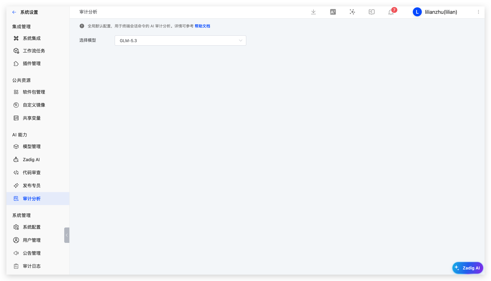

本文介绍 AI 审计分析的全局配置。该配置用于终端会话命令的 AI 审计分析。

## 配置

访问 `系统设置` -> `审计分析`，选择审计分析使用的模型。

参数说明：

- `选择模型`：审计分析使用的模型，从 [模型管理](/cn/Zadig%20v5.1/ai/ai-model/) 中已接入的模型里选择。

## 使用

在 [命令审计](/cn/Zadig%20v5.1/settings/auditlog/#命令审计) 中回放终端会话时，系统使用此处选择的模型分析会话中的命令，给出风险等级，并展示已分析命令数、风险项以及分析起止时间。
