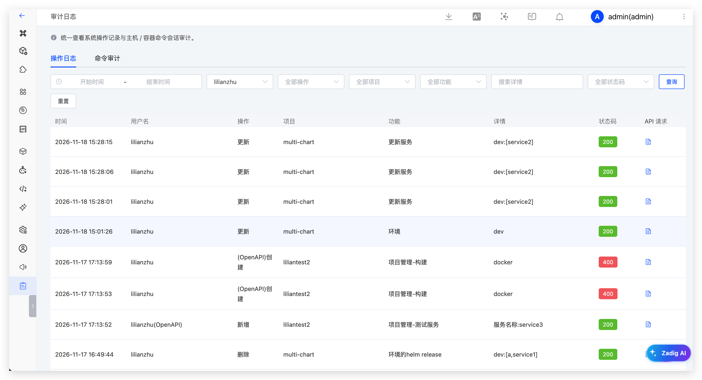
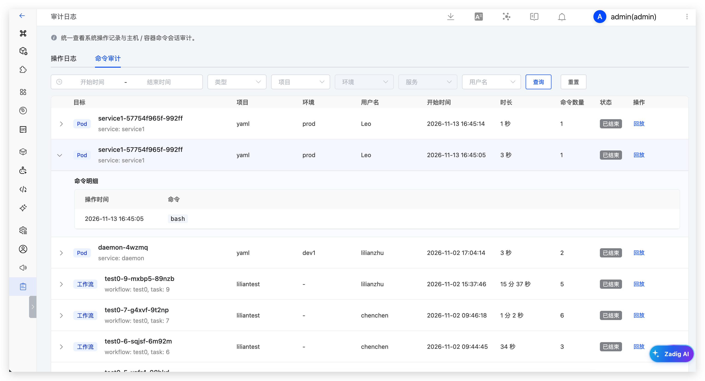
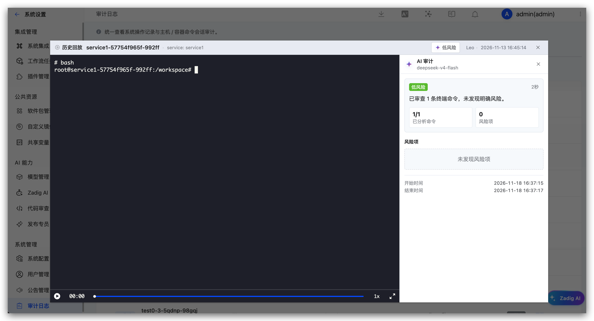

本文介绍 Zadig 系统中的审计日志。管理员可统一查看系统操作记录，以及主机 / 容器中的命令会话，以满足安全性和合规性要求。

访问 `系统设置` → `审计日志`。页面包含 `操作日志` 和 `命令审计` 两个页签。

## 操作日志

记录用户在系统中的操作，包括操作者、操作对象、功能模块、状态码以及 API 请求信息。

支持按时间范围、用户、操作、项目、功能、详情和状态码筛选。

## 命令审计

记录在 Pod 或工作流中执行的命令会话，可查看命令明细，并回放会话。

支持按时间范围、类型、项目、环境、服务和用户名筛选。

列表字段说明：

- `目标`：命令会话对象。`Pod` 会话展示 Pod 名称及所属服务；`工作流` 会话展示工作流任务标识
- `项目`：会话所属项目
- `环境`：会话所属环境。工作流任务会话为空
- `用户名`：执行命令的用户
- `开始时间`：会话开始时间
- `时长`：会话持续时长
- `命令数量`：会话中执行的命令条数
- `状态`：会话状态，例如 `已结束`
- `操作`：点击 `回放` 可回放该次命令会话

展开会话可查看 `命令明细`，包括每条命令的 `操作时间` 和 `命令` 内容。

点击 `回放` 可查看命令会话的历史回放。回放时，系统使用已集成的大模型对终端命令进行 AI 审查，给出风险等级，并展示已分析命令数、风险项以及分析起止时间。

