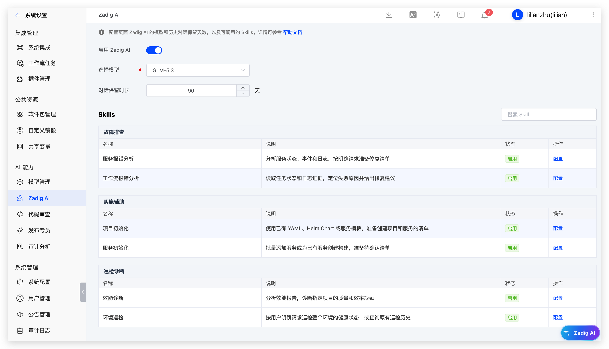

This article introduces how to configure and use Zadig AI. Zadig AI uses an integrated model together with the current page context to troubleshoot failures, initialize projects and services, and diagnose environments and efficiency.

## Configuration

Go to `System Settings` → `Zadig AI` to configure the model, conversation retention period, and available Skills.

Parameter description:

- `Enable Zadig AI`: Turn Zadig AI on or off.
- `Select Model`: The model used for Zadig AI conversations. Choose one from the integrated models.
- `Conversation Retention`: How many days to keep conversation history.

### Skills

Skills are the capabilities Zadig AI can call. You can search by name. Each Skill can be enabled or disabled separately. Click `Configure` to adjust it.

| Group | Name | Description |
| --- | --- | --- |
| Troubleshooting | Service Error Analysis | Analyze service status, events, and logs, and prepare a fix list for an explicit request |
| Troubleshooting | Workflow Error Analysis | Read task status and log evidence, locate the failure cause, and provide fix suggestions |
| Implementation Assistance | Project Initialization | Use existing YAML, Helm Chart, or service templates to prepare a checklist for creating the project and services |
| Implementation Assistance | Service Initialization | Add services in bulk or create builds for existing services, and prepare a confirmation list |
| Inspection and Diagnostics | Efficiency Diagnostics | Analyze efficiency reports and diagnose quality and efficiency bottlenecks for a specified project |
| Inspection and Diagnostics | Environment Inspection | Inspect the health of an entire environment when explicitly requested, or query existing inspection history |

## Usage

Open Zadig AI from the lower-right corner of the page. Select a quick scenario, or ask a question about the current page. Zadig AI uses the current project, workflow, or environment to provide analysis and suggestions. Previous conversations can be opened again from the panel.
