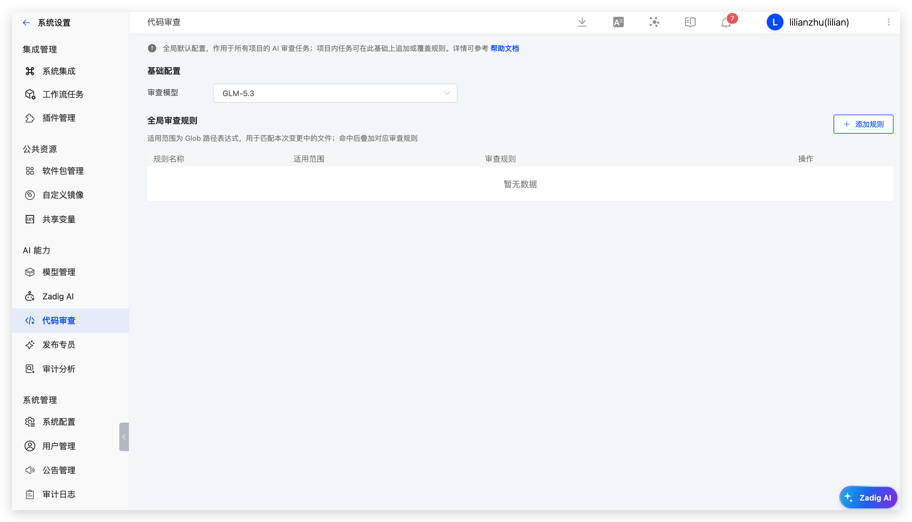

This article introduces the global configuration for AI code review. It applies to AI review tasks in all projects. A project task can append or override rules on top of it.

## Configuration

Go to `System Settings` → `Code Review` to configure the review model and global review rules.

### Basic Configuration

- `Review Model`: The model used for AI review. Choose one from the models integrated in [Model Management](/en/Zadig%20v5.1/ai/ai-model/).

### Global Review Rules

The scope is a Glob path expression used to match files in the current change. When a file matches, the corresponding review rule is applied. Click `Add Rule` to create a rule.

- `Rule Name`: Name of the rule.
- `Scope`: A Glob path expression that matches files in the current change.
- `Review Rule`: The review rule applied to matched files.

## Usage

When you create an AI review in a project, it uses the review model and global review rules configured here. A repository can also define its own review rules to append to or override the global rules. For task configuration and execution, see [AI Review](/en/Zadig%20v5.1/project/scan/#ai-review).
