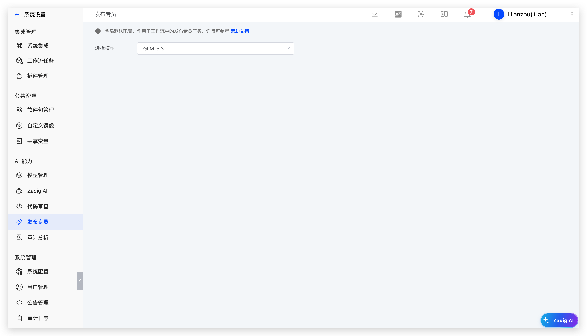

This article introduces the global configuration for the AI Release Specialist. It applies to Release Specialist tasks in workflows.

## Configuration

Go to `System Settings` → `Release Specialist` and select the model used by the Release Specialist.

Parameter description:

- `Select Model`: The model used by the Release Specialist. Choose one from the models integrated in [Model Management](/en/Zadig%20v5.1/ai/ai-model/).

## Usage

After you add an AI Release Specialist task to a workflow, the task uses the model selected here. It analyzes risk from the change and release context, then outputs conclusions and recommendations. For task configuration and execution, see [AI Release Specialist](/en/Zadig%20v5.1/project/workflow-jobs/#ai-release-specialist).
