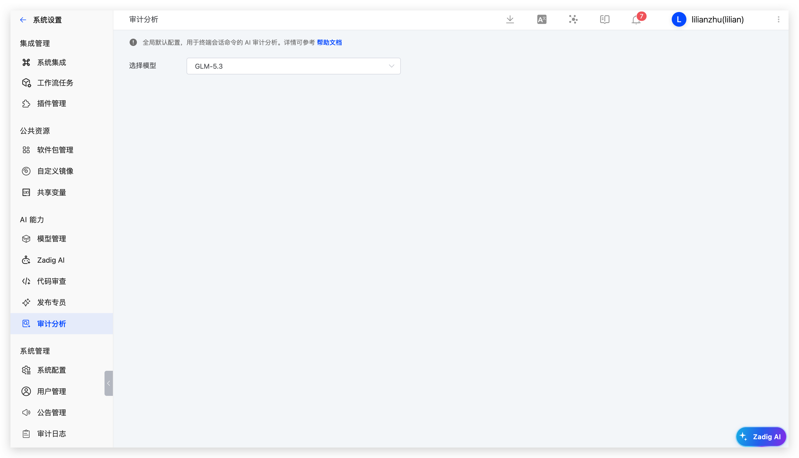

This article introduces the global configuration for AI audit analysis. It is used to analyze commands from terminal sessions.

## Configuration

Go to `System Settings` → `Audit Analysis` and select the model used for audit analysis.

Parameter description:

- `Select Model`: The model used for audit analysis. Choose one from the models integrated in [Model Management](/en/Zadig%20v5.1/ai/ai-model/).

## Usage

When you replay a terminal session in [Command Audit](/en/Zadig%20v5.1/settings/auditlog/#command-audit), the system uses the model selected here to analyze the commands in the session. It provides a risk level, and shows the number of analyzed commands, risk items, and the analysis start and end time.
