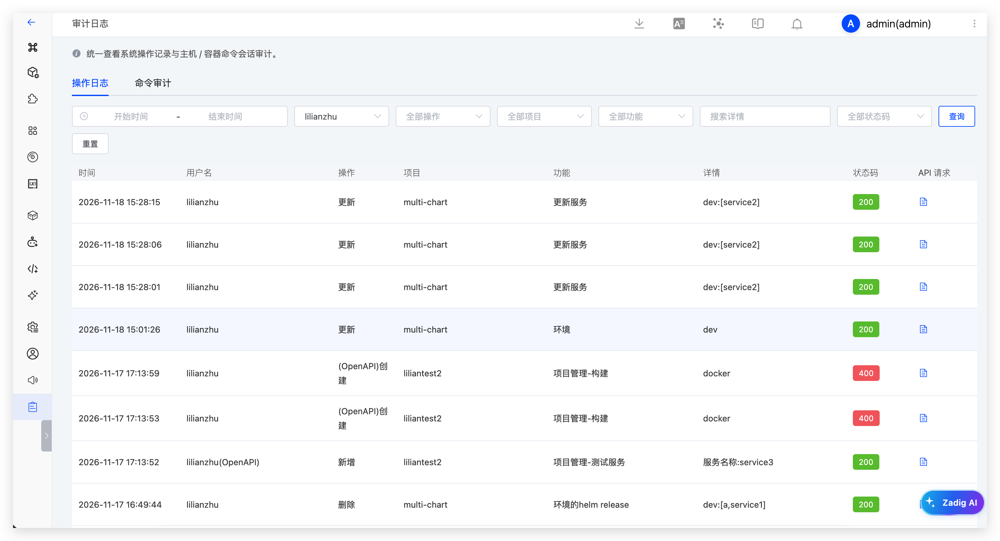
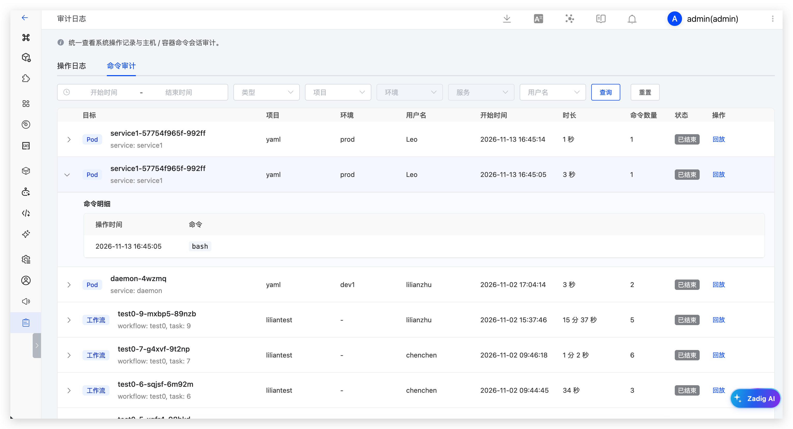
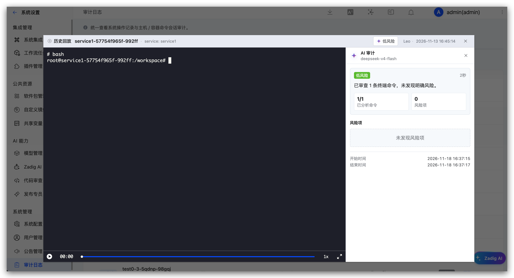

This article introduces the audit log in the Zadig system. Administrators can view system operation records and command sessions on hosts and in containers to meet security and compliance requirements.

Go to `System Settings` → `Audit Log`. It includes `Operation Log` and `Command Audit`.

## Operation Log

Records user operations in the system, including the operator, operation target, feature module, status code, and API request information.

Filter by time range, user, operation, project, feature, details, and status code.

## Command Audit

Records command sessions executed in Pods or workflows. You can view command details and replay sessions.

Filter by time range, type, project, environment, service, and username.

Field description:

- `Target`: The command session object. A `Pod` session shows the Pod name and its service. A `Workflow` session shows the workflow task identifier.
- `Project`: The project the session belongs to.
- `Environment`: The environment the session belongs to. Workflow task sessions leave this empty.
- `Username`: The user who executed the commands.
- `Start Time`: When the session started.
- `Duration`: How long the session lasted.
- `Command Count`: The number of commands executed in the session.
- `Status`: The session status, for example `Ended`.
- `Action`: Click `Replay` to replay the command session.

Expand a session to view `Command Details`, including the `Operation Time` and `Command` of each command.

Click `Replay` to view the historical playback of the command session. During playback, the system uses an integrated large language model to review the terminal commands, provides a risk level, and shows the number of analyzed commands, risk items, and the analysis start and end time.

